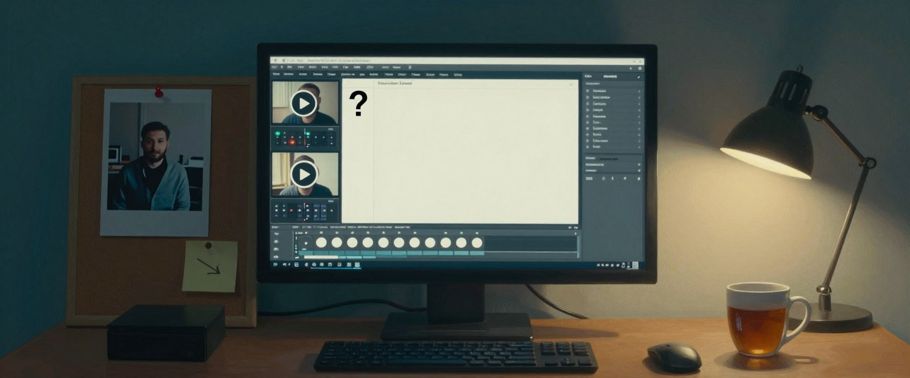

# askwright



When an AI agent needs you to decide things, askwright puts its questions on a local page, one per screen, and
hands your answers back to the agent as files. You answer when you have a minute; the agent reads the answers
when you are done.

The agent writes only data (`questions.json`). The page, the server and the checks are fixed code with tests, so
every question page is as good as the best one, instead of whatever the agent improvised that day.

## What you get on the page

- One question per screen, read top to bottom: the project and set it belongs to, the question as the heading,
  why it matters, and what to look or listen for. Times in "what to look for" turn into "Play from 6.0 s" buttons.
- The project's name in the top bar and a "Copy continue prompt" button: it copies a prompt that tells an agent to
  read the answers (with absolute paths), check them against its guesses and act on them, plus the counts so far.
- Click to pick: click a picture to choose the option it shows, or the Pick button under a clip or sound (their
  own click still plays and seeks). A side-by-side clip gets "Pick the left take" and "Pick the right take".
- A page per project: its description, when it was created and last worked on, its repositories and folders, and
  its question sets (`ask.py project NAME --description TEXT --repo URL --dir DIR`). Every time on the pages reads
  "3 hours ago", with the exact time on hover.
- A listen bench for voices and sounds: one row per clip with a big play button, the line spoken, a seek bar and
  the time; one clip plays at a time, `b` switches to the next clip at the same point, Shift+1 to Shift+9 play
  clip N. Blind voice picks show "Left"/"Right" until you pick. A sample on an option plays from a small button.
- Video, audio and images in the question. Takes compared side by side show "Left" and "Right" until you pick,
  then reveal which take was where.
- Image-heavy questions show one case at a time, with Previous/Next, a case selector and a full-size image link.
  Three or more images use this automatically; `media_layout` can request a gallery or a simultaneous stack.
- `refs` list the folder to test in, source files and git or other links, with Open folder and Copy. `tabs` hold long background and images beside the question.
- Background starts collapsed, with an expand/collapse control. Independent decisions still get separate
  questions. Batch evaluations collect frame-by-frame picks first, with specific Good / Keep / Reject checks;
  the agent recommends an overall model or workflow afterward.
- The agent's guess under the options. A confident guess is shown; an unsure one waits behind "Show my guess",
  and the agent learns whether you opened it before you picked. Nothing is ever pre-selected.
- "Not sure, ask me later" and "Something else" on every question.
- A note box that takes pasted or dropped screenshots. Typing while a clip plays pauses it and offers to tie the
  note to that moment.
- Answered questions leave the line. The page reopens on the first unanswered one with a "welcome back" line
  naming what is left, and ends on a check-your-answers screen with Change links.
- Keys for everything: `1`-`9` pick, `n`/`p` move, `u` for not sure, `/` for the note, Space, `j`/`l` and `[`/`]`
  for the clip, `?` for the list.
- Every change saves at once to the set folder. Light and dark themes, WCAG 2.2 AA, no network access.

## Study mode: quizzes that teach

Set `"mode": "study"` and the same page becomes a quiz. Each multiple-choice question has one right option and a
`why` on every option, so the review after "Submit" shows the score, a score per topic ("Net force 2 / 3 · practice
this"), and for every question your answer, the right one and why each option is right or wrong. Written
questions wait for the agent to grade them (`ask.py grade`). "Try again" reshuffles the options and keeps earlier
attempts in `results.json`. The answer key and the real option ids never reach the browser before submitting.
Graphs, force diagrams and simple drawings can be drawn from a few lines of JSON (`"figure"` media), in either mode.
How to write good wrong answers and explanations: [the Study mode wiki page](https://github.com/m4bwav/askwright/wiki/Study-Mode#how-to-write-a-study-set).

## What the agent gets back

```
python ask.py status ask/reel-takes-2
{"ok": true, "answered": ["g08-arrow", ...], "note_only": ["g11-gate"], "unanswered": ["g12-citadel"], "done": true, ...}

python ask.py read ask/reel-takes-2
{"answers": [{"qid": "g08-arrow", "choice": "t5", "label": "Take 5", "side": "right", "matched_guess": true,
  "note": "keep the shaft thin", "attachments": [".../attachments/g08-arrow-1.png"], "timecodes": [{"t": 6.4}], ...}]}
```

A note without a pick comes back as `note_only`, never as a choice, and unanswered questions stay unanswered.
The agent is told never to fill them with its guess.

## Install

As a Claude Code plugin:

    /plugin marketplace add m4bwav/askwright
    /plugin install askwright@askwright

As a plain skill for any agent that reads Agent Skills (Copilot, Codex, Cursor and others), clone the repository
and link `skills/askwright` into the agent's skills folder:

    git clone https://github.com/m4bwav/askwright
    # Windows (a junction needs no admin rights)
    New-Item -ItemType Junction -Path "$HOME\.claude\skills\askwright" -Target "$PWD\askwright\skills\askwright"
    # macOS / Linux
    ln -s "$PWD/askwright/skills/askwright" ~/.claude/skills/askwright

It needs Python 3.9 or later and nothing else. Use `python` on Windows and `python3` on macOS and Linux.

## Quick start

Ask your agent something like "put these three takes on a page and ask me which to keep". With the skill
installed it will write a set and serve it. By hand:

    python skills/askwright/scripts/ask.py new ask/first --title "Try askwright"
    # add questions to ask/first/questions.json (skills/askwright/references/schema.md has every field)
    python skills/askwright/scripts/ask.py lint ask/first
    python skills/askwright/scripts/ask.py serve ask/first --detach --open
    python skills/askwright/scripts/ask.py read ask/first
    python skills/askwright/scripts/ask.py stop ask/first

## Documentation

The [wiki](https://github.com/m4bwav/askwright/wiki) has every command with its real output, the question-set
format, every lint rule with its message, recipes and an FAQ. [skills/askwright/references/schema.md](skills/askwright/references/schema.md)
lists every field.

## One inbox for all sessions, one page per project

    python skills/askwright/scripts/ask.py dashboard --detach --open

Or run `ask.py shortcut` once for a desktop icon that starts and opens it, and `ask.py shortcut --startup` (Windows)
to start it at sign-in.

One server, one port. Since 0.28.0 the inbox and every set run in a single process on `http://127.0.0.1:47631/`
(`ASKWRIGHT_PORT` moves it); a set's page is `/s/<key>/` under it, so links and bookmarks survive restarts.
`serve` starts the server when it is down and replaces one older than the script, on the same port. If another
program holds the port, it falls back to the port it used last. `serve --own` (or `--port N`, or `--remote`)
still gives a set a server of its own. When steerwright 0.5.0 or later is installed, the same server carries its
pages at `/steer/` (read-only, sandboxed so their scripts cannot reach the answer token); with an older
steerwright, `/go/steerwright` starts steerwright's own server first.

A master page for every registered question set on this computer, with a bookmarkable URL. Sets register when
agents create or serve them. Sessions are a table (filter by project or product, search, sort, snooze, archive,
copy the continue prompt); the Projects tab lists every project with its status. A project page shows its goals, status, newest continue prompt, HANDOFF.md, question sets and history. Details: [Dashboard and projects](https://github.com/m4bwav/askwright/wiki/Dashboard-and-Projects).

## ask.py

| Command | What it does |
|---|---|
| `new <dir> --title T` | Writes an empty set. `--project NAME`, `--project-path DIR`, `--continue-prompt TEXT` (or `--continue-prompt-file FILE`), `--back-link URL LABEL`, `--product`, `--session`, `--asked-by`. |
| `lint <set>` | Checks the set: questions end in `?`, say why and what to look for, options name actions, every question carries a guess, media exists inside the allowed folders. Every rule: [the wiki](https://github.com/m4bwav/askwright/wiki). |
| `serve <set>` | Lints, then serves the page on 127.0.0.1 after fetching the page, the API and a clip with a Range request itself. `--detach` returns at once; `--open` opens your browser. |
| `status <set>` | Counts and lists; `--wait-done --timeout S` waits for "All done". |
| `read <set>` | Every answer; `--since REV` only newer ones. Logs the read (`--by WHO`) in the set's `uses.jsonl`. |
| `consume <set> --by WHO --note TEXT` | Records that the answers were acted on. The dashboard's Unconsumed tab lists sets that were read but have answers newer than their last consume. |
| `close <set> <qid>...` | Closes questions, or marks them `--superseded-by X` or `--withdrawn "reason"`. |
| `add <set> <file>` | Adds questions (a new round); a question with `supersedes` retires the old one. Refuses anything that fails the lint. |
| `inline <set>` | A chat version of a small set (4 or fewer plain questions), plus an AskUserQuestion mapping. |
| `grade <set>` | Study sets: lists written answers with their rubric; `--apply <file>` writes grades back. |
| `figure <spec> <out.svg>` | Draws a figure spec (graph, forces, shapes) to an SVG file to look at. |
| `stop <set>` | Stops the set's server by its PID, after the server answers a ping proving it owns that PID. |
| `register <set>` | Adds an existing set to the shared local dashboard, deduplicated by its resolved folder. |
| `project [NAME]` | Creates or updates a project record (`--description`, `--repo`, `--dir`, `--goal`, `--status`, `--needs-direction Q`, `--note TEXT`, `--prompt-run FILE`); with no name, lists projects. |
| `picks build <dir> --out D` | One image per item: candidate images to sets (`--group REGEX`, `--guesses`, `--existing`); `picks export <set>... --out picks.json` merges the picks. |
| `shortcut` | A desktop icon that starts and opens the dashboard (`--dir` for another folder). |
| `gh-post <set> --repo O/R --issue N` | Posts the questions as one comment on an issue or pull request: a readable list plus a hidden `askwright:payload` block. Web media show inline; local media are listed as not attached. Writes `github.json`. |
| `gh-pull <ref>` | Makes a local set from the newest payload comment on `O/R#N`, or from a comment URL (`--out DIR`, default `ask/gh-<repo>-<n>`). Web images are downloaded into the set. |
| `gh-reply <set>` | Posts the answers back as a comment that links the question comment (a thread reply for a pull request review comment). The page's "Post answers to GitHub" button does the same. |
| `gh-answers <ref>` | Reads the answers a `gh-reply` comment carries, as JSON. |
| `dashboard` | The shared server: the inbox (Sessions, Projects, Unconsumed) and every set, on port 47631. Supports `--detach`, `--open`, `--port N` and `--stop`. |

Every command prints one JSON object, except `--version` (plain text) and a usage mistake (argparse text on
standard error, exit code 2).

## Works with

Other plugins ([grindwright](https://github.com/m4bwav/grindwright), [musicwright](https://github.com/m4bwav/musicwright), [sfxwright](https://github.com/m4bwav/sfxwright), [pixelwright](https://github.com/m4bwav/pixelwright), [voicewright](https://github.com/m4bwav/voicewright), [cinewright](https://github.com/m4bwav/cinewright)) put their open decisions and side-by-side takes on askwright pages. Details: [Works with](https://github.com/m4bwav/askwright/wiki/Works-With).

## Security

The server binds 127.0.0.1 only and serves media from the folders the set names, with symlinks resolved. Every API call needs a per-run token and a matching Host and Origin, so another web page cannot read or write your answers. Uploads are capped at 10 MB and checked by their bytes; the page loads nothing from the network under a strict CSP. Answers are data, not instructions. See [SECURITY.md](SECURITY.md).

### Answering from another device (opt-in)

Off unless you turn it on; installing askwright sets up nothing remote. `ask.py serve <set> --remote` puts a set behind
Tailscale Serve, so named people can answer from a phone or another computer: no public address, media stays on your
machine, the computer must be awake. Remote answers carry who sent them and are marked untrusted; notes that look like
instructions are held for you. Setup: [references/remote.md](skills/askwright/references/remote.md).

## Privacy

askwright has no hosted service and collects nothing. Questions, answers, notes and pasted images stay in the set
folder on your machine.

## Testing

    python tests/check_skills.py     # structure, links, line endings, secrets
    python tests/test_ask.py         # ask.py: lint rules and the server
    python scripts/budget.py         # size budget
    python tests/test_page.py        # the page in Chrome or Edge (development only)

CI runs the first three on Windows, macOS and Linux with Python 3.9 and 3.14. The page tests need
`pip install playwright` and Chrome or Edge, because the bundled Chromium does not play H.264.
`ASKW_SET=<set folder>` runs the generic page checks on a copy of a real set.

## Credits

The design draws on the GOV.UK Design System (one question per page, check answers, task list), on review tools
such as Prodigy, Label Studio and Frame.io, and on survey-method research. [RESEARCH.md](RESEARCH.md) cites each
source. The page tests use [axe-core](https://github.com/dequelabs/axe-core) (MPL-2.0), vendored under
`tests/vendor/` and not shipped with the skill.

## License

MIT. See [LICENSE](LICENSE).
